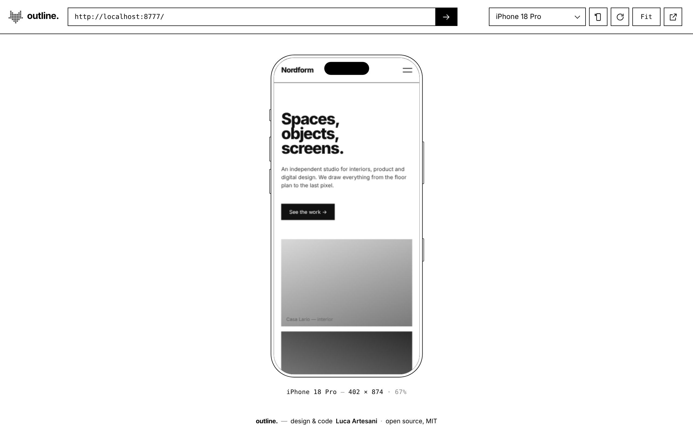
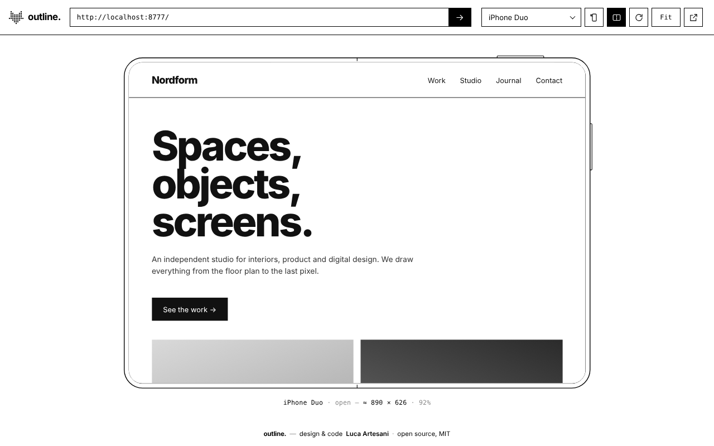
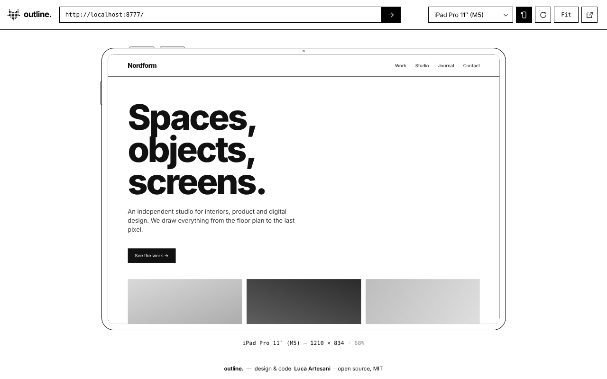
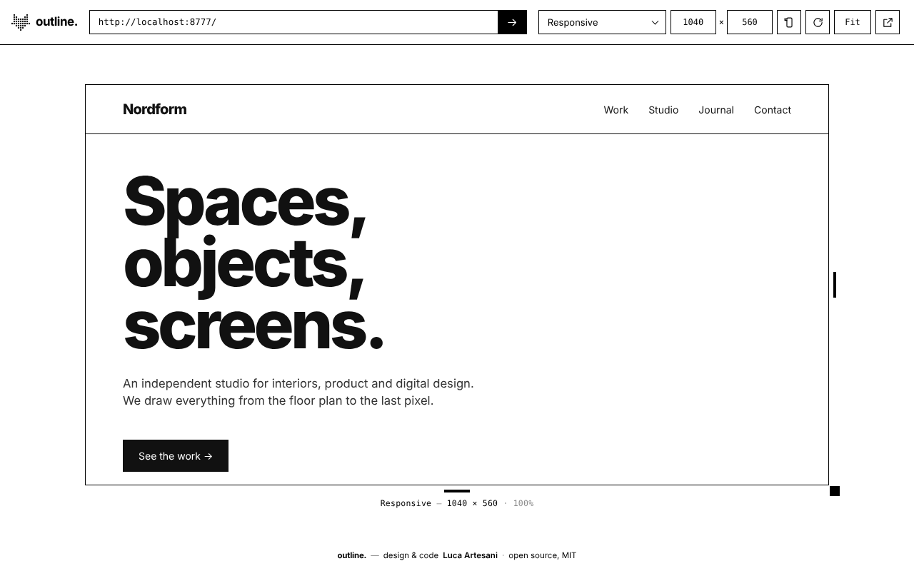

<p align="center">
  
</p>

<h1 align="center">outline.</h1>

<p align="center"><b>See any website on the latest phones, tablets and foldables, right inside Chrome.</b><br>
Paste a link and the site renders inside a minimal black-and-white outline of the device, at its real CSS viewport.</p>

<p align="center">
  
</p>

## Features

- **55 presets.**
  - **iPhone:** every model from iPhone 13 / 13 mini / SE (3rd gen) to iPhone 18 Pro Max and the foldable iPhone Duo
  - **iPad:** Pro 13″ / 11″ (M4 · M5), Pro 12.9″ (M2), Air 13″ / 11″ (M4), iPad (A16), iPad mini (A17 Pro, A20 Pro)
  - **Samsung:** Galaxy S24 → S26 (Ultra, +, base), A56, Z Fold8 / Fold8 Ultra, Z Flip7 / Flip8, Tab S11 / S11 Ultra
  - **Google:** Pixel 11 / 11 Pro / 11 Pro XL / 11 Pro Fold
  - **Desktop:** large (1920 × 1080), medium (1440 × 900), small (1366 × 768)
- **Desktop page zoom** (50 – 200 %, or `+` `−` `0`), to check layouts at the browser zoom or Windows scaling people actually use. 1920 × 1080 at 125 % lays out like a 1536 × 864 viewport.
- **Compare up to 5 sites** side by side on the same device (`+` next to the link, or `N`). Click a preview to edit its link, `×` to remove it, `1`–`5` to switch.
- **Foldables.** Open and close them (`F`) to switch between cover and inner screen.
- **Rotate** to landscape (`R`). The page keeps its state, like on a real phone.
- **Responsive mode.** A plain black border you can resize by dragging or by typing exact sizes.
- **Real mobile behaviour, not only width.** Each device gets:
  - its User-Agent (in HTTP headers *and* in `navigator.userAgent`)
  - its Client Hints
  - touch detection
  - overlay scrollbars
  - iPad presents itself as a Mac, as iPadOS Safari really does
- **Works with sites that refuse to be framed** (`X-Frame-Options`, CSP `frame-ancestors`), only inside the preview tab.
- **Local files and localhost.** Open an `.html` file in Chrome and click the icon, or paste a path or `localhost:3000`.
- **Frame-busting blocked.** The preview can't redirect the viewer.
- **Fit to window** or **100%** (`Z`).
- **Remembers** your last link and device. English and Italian UI.

| | | |
|---|---|---|
|  |  |  |

## Install

**Chrome Web Store:** *coming soon*

**From source:**

1. Download this repository (`Code → Download ZIP`) and unzip it, or `git clone` it
2. Open `chrome://extensions` and turn on **Developer mode**
3. Click **Load unpacked** and select the folder
4. *(For local `.html` files)* open the extension's **Details** and enable **Allow access to file URLs**

Click the icon (or press `Alt+Shift+O`). The viewer opens with the page you were on already loaded.

## Shortcuts

| Key | Action |
|---|---|
| `Alt+Shift+O` | Open outline. |
| `L` | Focus the link field |
| `N` | Add a site to compare (max 5) |
| `1`–`5` | Pick which site the link field edits |
| `R` | Rotate |
| `F` | Fold / unfold |
| `Z` | Fit / 100% |
| `+` `−` `0` | Page zoom (desktop) |

## How it works

| File | Role |
|---|---|
| `viewer.html / .css / .js` | The page: toolbar, device outlines (inline SVG), scaling, responsive handles |
| `devices.js` | Device catalogue: viewport sizes and frame geometry |
| `background.js` | Opens the viewer and cleans up rules when the tab closes |
| `emulate.js` | Runs only inside the preview frame and emulates UA, platform, touch and scrollbars |

Header changes use `declarativeNetRequest` **session rules scoped to the viewer tab's ID**. Your normal browsing is never touched, and the rules are removed when the viewer closes or navigates away.

## Notes and limits

- Sizes marked **≈** are approximate. The maker doesn't publish CSS viewport sizes, so they are derived from physical resolution ÷ pixel ratio.
- `devicePixelRatio` stays your monitor's, so images load at desktop density.
- Desktop Chrome ignores `<meta name="viewport">`. Pages with a fixed viewport width won't zoom out the way they do on a phone.
- Logins and third-party cookies inside the frame may not persist.

## Privacy

No data is collected. See [PRIVACY.md](PRIVACY.md).

## Add a device

Add an entry to `devices.js`:

```js
{
  id: 'my-phone', brand: 'Brand', name: 'My Phone', year: 2026,
  os: 'android',            // 'ios' | 'ipados' | 'android'
  w: 412, h: 915,           // CSS viewport, portrait
  frame: { bezel: 9, radius: 40, cutout: punch(11, 12), buttons: PIXEL_BUTTONS }
}
```

## Releasing

Bump `version` in `manifest.json`, then push a matching tag:

```bash
git tag v1.0.1 && git push origin v1.0.1
```

GitHub Actions builds `outline-v1.0.1.zip` and attaches it to a Release, ready for the Chrome Web Store.

## License

MIT © 2026 Tommaso Chiusi, Luca Artesani — [acadesign.eu](https://acadesign.eu)

---

### 🇮🇹 In breve

**outline.** è un'estensione Chrome open source: incolli un link e vedi il sito dentro il contorno dell'iPhone, iPad, Galaxy, Pixel o pieghevole più recente, oppure in modalità responsive ridimensionabile. Funziona anche con i file HTML locali. Installazione: `chrome://extensions` → Modalità sviluppatore → *Carica estensione non pacchettizzata*.
